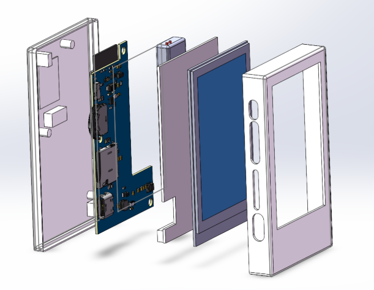
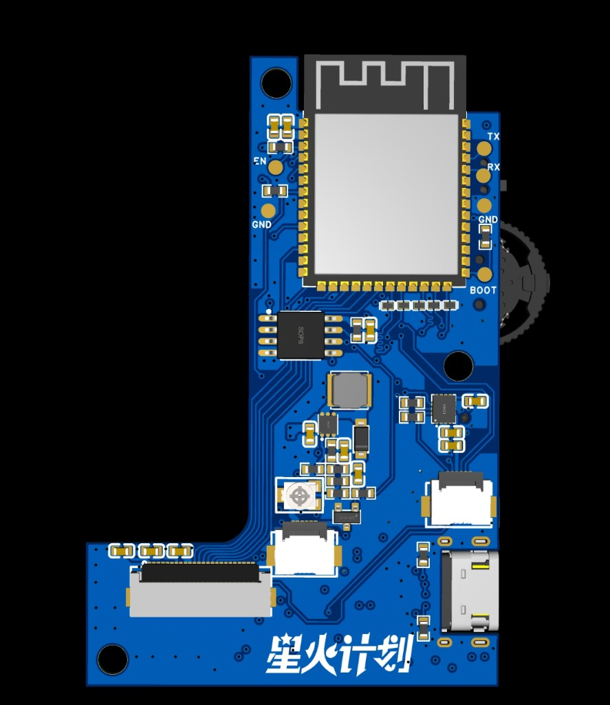

# ESP32-S3 Ebook

[中文](README.md)

## Overview

Ebook is an ESP-IDF–based e-reader for the ESP32-S3, built around a 2.7-inch e-paper display (GDEY027T91). A custom UI stack (router + composer + presenter pipeline) delivers smooth multi-app interaction on a low-power e-ink panel.

It supports Wi-Fi / BLE, microSD read/write, USB MSC file transfer, audio playback, and ships with built-in apps such as calendar, clock, reader, notepad, and music player.

## Features

- **E-paper display**: GDEY027T91 2.7-inch panel; full refresh, fast refresh, and partial refresh
- **Touch input**: FT6336U capacitive touch; tap and swipe gestures
- **DIP switch navigation**: 3-position ADC DIP switch (up / center / down) mappable to semantic actions
- **Wi-Fi**: connection setup, NTP time sync, WebSocket, HTTP client
- **Bluetooth BLE**: NimBLE-based; peripheral and central roles
- **Audio playback**: ES8311 codec; MP3 / WAV decoding
- **microSD storage**: SDMMC 4-bit bus, FAT32 for user data
- **USB MSC**: TinyUSB mass storage on the userdata partition
- **Battery management**: ADC sampling with live status-bar percentage
- **OTA upgrade (planned)**: dual OTA slots with rollback protection

## Hardware

<p align="center">
  
  <br><em>Assembly (rear shell → main board → battery/bracket → e-paper → front shell)</em>
</p>

<p align="center">
  
  <br><em>Main board — top view</em>
</p>

### MCU & peripherals

| Module | Model / spec |
|--------|----------------|
| SoC | ESP32-S3, 240 MHz, Octal PSRAM |
| Flash | 16 MB (QIO) |
| Display | GDEY027T91, 2.7-inch, 264×176, SPI |
| Touch | FT6336U, I2C, capacitive multi-touch |
| Audio | ES8311, I2S, speaker amplifier |
| Motion sensor | QMI8658A, I2C, accelerometer + gyroscope |
| Storage | microSD (SDMMC 4-bit) |
| Power | 500 mAh Li-ion, ADC voltage sensing |

### GPIO pin map

| Function | GPIO |
|----------|------|
| I2C SDA / SCL | GPIO2 / GPIO1 |
| I2S MCLK / SCLK / LRCK / DI / DO | GPIO41 / 40 / 39 / 42 / 38 |
| I2S amp enable | GPIO7 |
| GDEY027T91 MOSI / SCLK / CS / DC / RST / BUSY | GPIO3 / 46 / 9 / 10 / 11 / 12 |
| Display backlight PWM | GPIO17 |
| FT6336U RST / INT | GPIO18 / GPIO5 |
| microSD D0–D3 / CLK / CMD / CD | GPIO14 / 13 / 45 / 48 / 21 / 47 / 4 |
| ADC DIP switch | GPIO15 |
| Battery voltage ADC | GPIO6 |

## Applications

The app grid has **12 slots**.

### Implemented apps

| App | Description |
|-----|-------------|
| Reader | TXT bookshelf and reading; font size / progress / refresh mode; EPUB planned |
| Notepad | Multi-file TXT notes; scans `Ebook/notes` on `/int` and `/sd` |
| Gallery | JPEG (`.jpg` / `.jpeg`); scans `Ebook/photos` (int + sd) |
| Drawing | 1-bit BMP draw/export; saves under `Ebook/drawings` (int first, sd fallback) |
| Music | MP3 / WAV streaming; scans `Ebook/music` (int + sd) |
| Weather | [Amap Web API](https://lbs.amap.com): live + forecast, 31 cities, IP geolocation |
| Clock | Large clock + alarms |
| Calendar | Month view with year/month picker |
| Wooden fish | Tap counter and sound effects |
| Files | Browse `/int` (userdata) / `/sd` / `/assets` |
| Settings | Wi-Fi, Bluetooth, hotspot, display, keys, sound, time, storage, security, about, etc. |

### User content layout

User apps only scan fixed subfolders (no full-disk search). Internal Flash (`/int`) and microSD (`/sd`) share the same tree:

```
/int/Ebook/          /sd/Ebook/
├── txt/             ├── txt/         # Reader
├── music/           ├── music/       # Music
├── photos/          ├── photos/      # Gallery
├── notes/           ├── notes/       # Notepad
└── drawings/        └── drawings/    # Drawing exports (session cache stays on /int)
```

Add files via USB MSC (Settings → Storage), microSD, or seed `assets/fat_userdata/` before build. See [`assets/fat_userdata/README.txt`](assets/fat_userdata/README.txt).

### Placeholders / planned

| Item | Description |
|------|-------------|
| **Update** | Placeholder app in the grid |
| **OTA online upgrade** | Full upgrade flow not yet implemented |
| **EPUB reader** | Extended format for the reader app |
| **Settings → Battery** | Menu entry exists; page is still a placeholder |

## Software

### Flashing firmware

**Prerequisites**: `esptool` installed; device connected via USB Type-C for flashing. Debug logs are available on UART0 (GPIO43 / GPIO44).

Prebuilt firmware is on [GitHub Releases](https://github.com/CHENXiNNNX/Ebook/releases), or run `python scripts/package_firmware.py` locally to output to `dist/`. After extracting, open the version folder; **flash offsets and filenames follow `FLASH.md` inside the package**.

#### Option 1: idf.py (recommended for developers)

```bash
idf.py build flash
```

#### Option 2: esptool — per-partition flash

From the `flash/` folder in a release package (replace `COMx` with your serial port):

```bash
esptool.py --chip esp32s3 -b 460800 --port COMx write_flash 0x0      bootloader.bin
esptool.py --chip esp32s3 -b 460800 --port COMx write_flash 0x8000   partition-table.bin
esptool.py --chip esp32s3 -b 460800 --port COMx write_flash 0xd000   ota_data_initial.bin
esptool.py --chip esp32s3 -b 460800 --port COMx write_flash 0x20000  Ebook.bin
esptool.py --chip esp32s3 -b 460800 --port COMx write_flash 0x600000 assets.bin
esptool.py --chip esp32s3 -b 460800 --port COMx write_flash 0xA00000 userdata.bin
```

> Offsets follow [`partitions/partition_16mb.csv`](partitions/partition_16mb.csv); for release packages use the package `FLASH.md`.
#### Option 3: merged image (factory / first-time flash)

From the release package root; merged image name ends with `*_flash.bin`:

```bash
esptool.py --chip esp32s3 -b 460800 --port COMx write_flash 0x0 <merged-image>.bin
```

### Development environment

- VS Code or similar
- ESP-IDF extension, SDK **v5.4 or newer**
- Linux or WSL2 recommended for faster builds
- Code style: see [docs/coding_style.md](docs/coding_style.md) (LLVM + Allman; naming inspired by Google C++). Before commit: `py scripts/format_code.py -y` / `py scripts/check_code.py`

**Weather app (Amap)**: In `idf.py menuconfig` → `Ebook Configuration` → `高德API Key`, set your Web service key ([lbs.amap.com](https://lbs.amap.com); enable “Weather” and “IP location”). Kconfig symbol: `CONFIG_EBOOK_AMAP_WEATHER_KEY`.

### Project layout

```
Ebook/
├── main/
│   ├── app/
│   │   ├── ebook/                # UI framework & apps
│   │   │   ├── router/           # Router + refresh edge table
│   │   │   ├── presenter/        # Display pipeline
│   │   │   ├── composer/         # Frame composition
│   │   │   ├── display/          # DisplayPort driver adapter
│   │   │   ├── shell/            # System pages (Lock / Home / AppGrid / AppHost)
│   │   │   ├── apps/             # Built-in apps (reader / music / clock / ...)
│   │   │   ├── overlays/         # StatusBar / Toast / Keyboard / ControlCenter
│   │   │   ├── gfx/              # Drawing (Canvas / Font / Icon)
│   │   │   ├── ui/               # Widgets, UI main loop (ui_loop.cc)
│   │   │   ├── data/             # Shared data (Persist / SystemState)
│   │   │   ├── input/            # Touch / DIP input routing
│   │   │   ├── platform/         # Boot chain (boot.cc), battery, audio
│   │   │   └── text/             # Text layout, encoding
│   │   ├── network/              # Wi-Fi / BLE 
│   │   ├── protocol/             # HTTP / NTP / WebSocket / file_server
│   │   └── system/               # Task / Power / Event / Info
│   ├── bsp/
│   │   ├── config/               # GPIO config
│   │   ├── driver/               # Display / touch / audio / keys / IMU
│   │   └── i2c/                  # I2C bus wrapper
│   └── common/                   # Shared utilities
├── assets/
│   └── littlefs_assets/          # Fonts, icons, bundled assets
├── partitions/
│   ├── partition_16mb.csv        # 16 MB Flash partition table
│   └── partition_8mb.csv         # 8 MB Flash partition table
├── scripts/
│   └── package_firmware.py       # Firmware packaging script
├── dist/                         # Release packages
│   └── Ebook-vx.x.x/
│       ├── flash/                # Partition images
│       ├── ota/                  # OTA packages
│       ├── manifest.json         # Version & SHA256 manifest
│       └── FLASH.md              # Flashing instructions
├── patches/                      # managed_components patches (re-apply after reconfigure)
├── docs/                         # Documentation & hardware references
│   ├── README.md                 # Docs index
│   ├── hardware/                 # Schematics & PCB design
│   ├── images/                   # Product photos (README)
│   └── datasheets/               # Datasheets (esp32-s3 / ft6336u / gdey027t91)
├── CMakeLists.txt                # Build entry
├── sdkconfig.defaults            # Default Kconfig
└── sdkconfig.defaults.esp32s3    # ESP32-S3 Kconfig overrides
```

### Flash partition table (16 MB, see `partitions/partition_16mb.csv`)

| Partition | Type | Offset | Size | Purpose |
|-----------|------|--------|------|---------|
| nvs | data/nvs | 0x9000 | 16 KB | Wi-Fi config, persisted settings |
| otadata | data/ota | 0xd000 | 8 KB | OTA active slot record |
| phy_init | data/phy | 0xf000 | 4 KB | RF calibration |
| ota_0 | app/ota_0 | 0x20000 | ~2.94 MB | Application slot 0 |
| ota_1 | app/ota_1 | — | ~2.94 MB | Application slot 1 (OTA target) |
| assets | data/littlefs | 0x600000 | 4 MB | Read-only fonts / IME (`/assets`) |
| userdata | data/fat | 0xA00000 | 6 MB | User FAT + wear levelling (mounted as **`/int`**) |

Prefer microSD (`/sd`) for large books / music / photos. An 8 MB layout is available in [`partitions/partition_8mb.csv`](partitions/partition_8mb.csv).

### Dependencies

| Component | Version |
|-----------|---------|
| h2zero/esp-nimble-cpp | ^2.5.0 |
| espressif/esp-idf-cxx | ^1.0.2-beta |
| espressif/cjson | ^1.7.19 |
| espressif/esp_tinyusb | ^2.2.0 |
| espressif/esp_websocket_client | ^1.7.0 |
| joltwallet/littlefs | ^1.21.1 |
| espressif/esp_codec_dev | ^1.5.10 |
| espressif/freetype | ^2.14.2 |
| cfscn/esp_lcd_touch_ft6x36 | ^1.0.8 |
| espressif/esp_audio_codec | ^2.5.0 |
| espressif/esp_jpeg | ^1.3.1 |

### Developer docs

- [Ebook framework guide](main/app/ebook/README.md) (Chinese)
- [Coding style](docs/coding_style.md) (Chinese)
- [Userdata layout](assets/fat_userdata/README.txt)
- [Assets layout](assets/littlefs_assets/README.txt)
- [Component patches](patches/README.md)
- [Hardware / datasheet index](docs/README.md)

## About

An open-source e-ink reader project for ESP32-S3, licensed under [MIT](LICENSE).

Issues and suggestions are welcome.
