# Ebook 项目架构与工作链路（图解版 · 面试用）

> 面向：面试讲解 / 新人上手 / 复习。
> 原则：一张图只讲一件事；看图先看"数据往哪流"，再看"谁调用谁"。
> 代码位置均以 `main/` 为根。

**配套材料**

- `图解/index.html`：把下面所有图排成一页的图解手册（浏览器打开，可直接打印）
- `图解/01~11-*.png`：2 倍分辨率图片，面试时可直接投屏或放进任意文档
- 本文档：同样的内容用 Mermaid 描述，便于在 GitHub / VSCode 里直接预览与改图

---

## 0.5 从零到整机的开发顺序（主线）

这一节回答“如果重做一遍，代码先写哪个、后写哪个，最后怎么合成一个整体”。
核心原则：**每一层都必须能单独验证，验证通过再往上叠。**

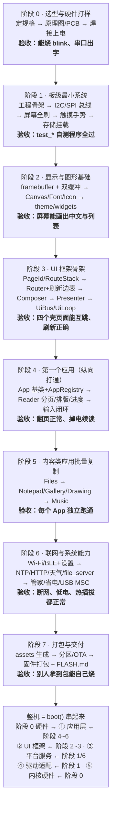

| 阶段 | 主要产出 | 代码落在 | 做完的标志 |
|---|---|---|---|
| 0 选型与硬件 | 引脚表、原理图/PCB、能上电的板子 | `docs/hardware`、`docs/datasheets` | 烧个 blink，串口有 log |
| 1 板级最小系统 | 工程骨架 + 4 个外设驱动 | `bsp/`、`common/storage`、`partitions/` | `test_gdey027t91` / `test_storage` 全过 |
| 2 显示与图形 | 1-bit framebuffer、Canvas、字体、控件 | `display/` `gfx/` `ui/` | 屏上能画中文与列表 |
| 3 UI 框架骨架 | 路由栈、刷新边表、合成器、上屏管线、事件队列 | `router/` `composer/` `presenter/` `ui/` | Lock/Home/AppGrid/AppHost 能互跳 |
| 4 第一个应用 | App 基类 + 阅读器 + 输入闭环 | `apps/` `input/` `ime/` | 翻页、返回、续读都正常 |
| 5 内容类应用 | 文件、记事、相册、画板、音乐 | `apps/*` `platform/music_player` | 各 App 独立可用、互不影响 |
| 6 联网与系统 | Wi-Fi/BLE、NTP/HTTP/天气、管家/省电/USB MSC | `network/` `protocol/` `platform/` | 断网/低电/热插拔行为正确 |
| 7 打包交付 | assets、分区与 OTA、发布包 | `tools/` `scripts/` `partitions/` | 按 FLASH.md 烧录即可点亮 |

**为什么必须按这个顺序**（面试可以直接讲）：

1. **硬件不通就写驱动 = 猜**：先把电压、晶振、串口三件事确认，再调 SPI/I2C。
2. **驱动没验证就写 UI = 赌**：每个外设留一个 `main/test/` 自测程序，出问题时能立刻分层定位。
3. **框架没稳就写 12 个 App = 同时踩 12 个坑**：先用一个最复杂的阅读器把纵向链路走穿。
4. **最后才联网**：网络/解码/存储都是“慢且会失败”的东西，等 UI 与事件模型稳定后再接，
   失败路径才不会把界面拖死。
5. **整合点是 `boot()`**：它按依赖顺序调用各阶段产出的初始化函数，任何一层没就绪，
   启动日志都会指出是哪一步失败 —— 这就是“一步步集合成一个整体”的落点。

---

## 0. 一句话介绍（30 秒版）

> 这是一个跑在 **ESP32-S3** 上的 **2.7 英寸墨水屏电子书**：自己写了一套轻量 UI 框架
> （**路由 + 合成器 + 上屏管线**），把"墨水屏刷新慢、只能黑白、不能局部重绘"这些限制
> 封装在框架层，上层 12 个应用（阅读、记事、相册、音乐、天气……）用统一的
> `paint() / on_input()` 接口接入，就能获得流畅的页面切换与刷新体验。

| 维度 | 数据 |
|---|---|
| 主控 | ESP32-S3，240 MHz，Octal PSRAM，16 MB Flash |
| 屏幕 | GDEY027T91 2.7" 墨水屏，176×264，1-bit（1 像素 1 bit），SPI |
| 一帧大小 | 176/8 × 264 = **5,808 字节**（`core::kFbBytes`） |
| 交互 | FT6336U 电容触摸（I2C + 中断）、三段 ADC 拨码开关 |
| 应用 | 12 项（11 个可用 + 1 个"更新"占位）|
| 框架 | ESP-IDF v5.4+（FreeRTOS）、esp-nimble-cpp、esp_audio_codec、littlefs、freetype |

---

## 1. 项目全景架构图

看这张图的顺序：**最上面是用户能看到的，最下面是最接近硬件的**。
每层只依赖它下面一层；下层的异步结果（网络、解码、存储）**不能直接改 UI**，
必须通过 `UiBus` 事件队列回到 UI 线程。

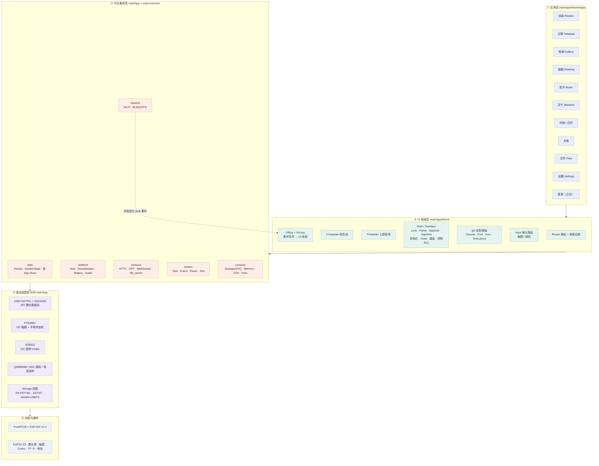

**面试一句话**：
"我是按 **应用 / 框架 / 服务 / 驱动 / 硬件** 五层切的，横向是模块，纵向是依赖，
所有跨层的异步结果都收敛到 `UiBus` 这一条入口，保证 UI 状态只在 UI 线程里被修改。"

---

## 2. 硬件连接图（谁挂在哪个总线上）

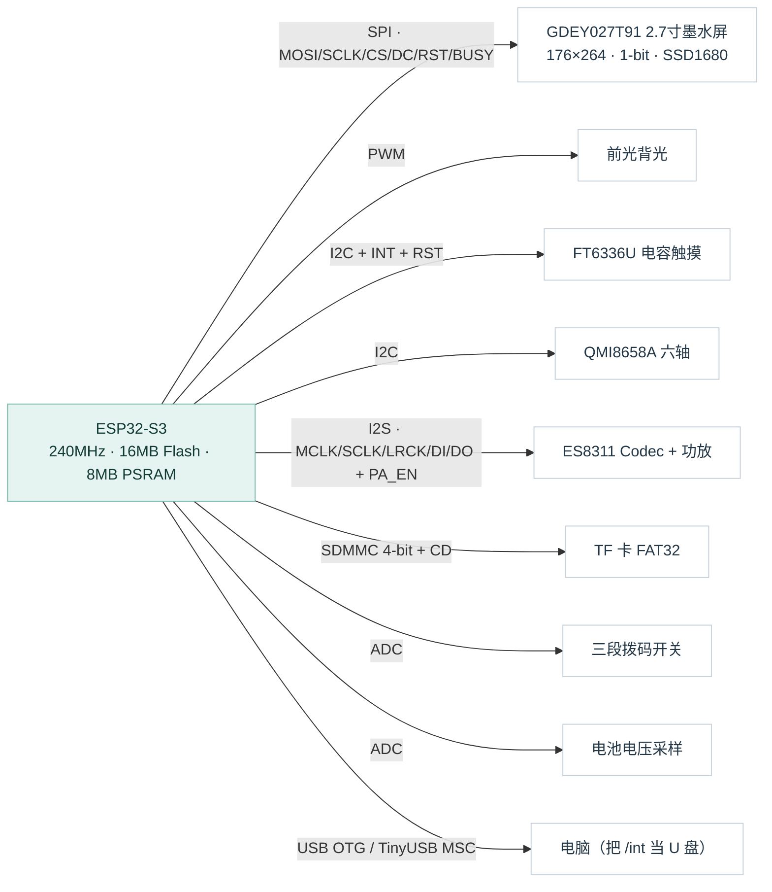

设计取舍（面试会被问"为什么"）：
- **墨水屏用 SPI 不用 I2C**：刷新要连续写几 KB 显存，SPI 快且简单。
- **触摸用 I2C**：数据量小（几个字节坐标），省引脚。
- **拨码用 ADC**：三段开关用分压电阻接一个 ADC 脚，比 3 个 GPIO 省引脚。
- **电池用 ADC 分压采样**：不能直接测，需要电阻分压到 ADC 量程内。

---

## 3. 启动链路（从复位到第一帧）

入口极短：`app_main()` → `ebook_app_run()` → `boot()`。
`boot()` 是一张**有序步骤表**，每步带 `required` 标记：可选步骤失败只打警告，关键步骤失败则终止。

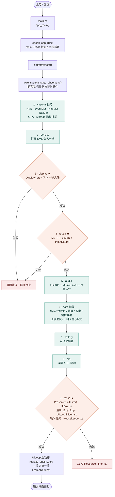

要点：
1. **顺序有依赖**：显示要在 UI 之前，触摸要在 InputRouter 之前，存储要在读进度之前。
2. **★ 是关键步骤**（`required = true`），其余失败只降级。
3. 输入法、音频、拨码都是**可降级**的：坏了不至于开不了机。
4. 启动完成后 `main` 任务只剩 `delay(5000)` 空转，真正的活都在各任务里。

---

## 4. 核心：一帧画面是怎么上屏的（重点讲这个）

这是整个项目最值得讲的部分。**四个角色，职责严格分开**：

| 角色 | 职责 | 不做什么 |
|---|---|---|
| `UiLoop`（UI 任务） | 取事件、分发输入、改 UI 状态、调 `paint()` | 不碰硬件、不做慢操作 |
| `Router` | 改页面栈 + 用"刷新边表"决定用什么波形 | 不画像素 |
| `Composer` | 把 Shell/App/Overlay 按顺序画进**后备帧** | 不认识屏幕时序 |
| `Presenter` | 队列合并请求 → 拷帧 → 生成刷新计划 → 调 DisplayPort | 不懂业务 |

```mermaid
flowchart LR
    subgraph UI["UI 任务（ebook_ui, 24KB, NORMAL）"]
        EV["UiBus 取事件<br/>输入 / Tick / 网络状态"] --> H{"handle_event<br/>按类型分流"}
        H --> APP["当前页面 on_input / on_ui_event"]
        APP --> NAV["Router.navigate / repaint"]
        NAV --> EDGE["RefreshEdges.resolve<br/>（from,to,action）→ 波形"]
        EDGE --> REQ["FrameRequest{transition,intent,seq}"]
        REQ --> SUB["Presenter.submit()"]
        SUB --> PAINT["Composer.paint(back_fb)<br/>清屏 → Shell → App → Overlay"]
    end

    PAINT --> Q[("FrameRequest 队列<br/>深度 4 · 只保留最新")]
    Q --> TASK["Presenter 任务（6KB, HIGH）"]
    TASK --> MERGE["取出后把队列里<br/>剩下的请求全部丢弃<br/>只执行最新一帧"]
    MERGE --> LOCK["加 fb 互斥锁"]
    LOCK --> COPY["copy_fb()<br/>back_fb → DisplayPort.framebuffer()"]
    COPY --> PLAN["make_plan(intent, can_partial)<br/>波形 → 步骤列表"]
    PLAN --> DP["DisplayPort<br/>bootstrap / partial / fast / full"]
    DP --> DRV["SSD1680 驱动<br/>发命令 → 写 RAM → 等 BUSY"]
    DRV --> EPD(["屏幕更新完成"])
    DRV -.->|"idle 事件组置位"| SUB

    classDef ui fill:#E8EEFC,stroke:#93A9DE,color:#1B2B4B;
    classDef pipe fill:#E6F4F1,stroke:#79B9AC,color:#123B35;
    classDef drv fill:#EFEBFA,stroke:#B4A8DE,color:#2B2352;
    class EV,H,APP,NAV,EDGE,REQ,SUB,PAINT ui;
    class MERGE,LOCK,COPY,PLAN,TASK pipe;
    class DP,DRV drv;
```

**四个关键设计（面试可以直接背）**：

1. **双 framebuffer**：`back_fb`（合成目标，PSRAM）与 `DisplayPort.framebuffer()`（驱动帧）。
   合成发生在 UI 任务，拷贝发生在 Presenter 任务，中间用 `fb_mutex_` 互斥 —— 避免"画一半被刷上去"的撕裂。
2. **队列合并（只刷最新）**：队列深度 4，`task_main` 取出一个后把剩余全部丢弃。
   墨水屏一帧要几百毫秒，连续滑动若逐帧刷会严重滞后 —— 合并后保证**屏幕追的是最新状态**。
3. **idle 事件组**：`submit()` 先等 `kBitIdle`，刷完再置位；配合 `wait_idle()` 让高频重绘不会堆积。
4. **失败自愈**：局刷失败 → `invalidate_session()` → 退化成 `bootstrap + partial` 重来一遍。

---

## 5. 一次点击的完整时序（从手指到屏幕）

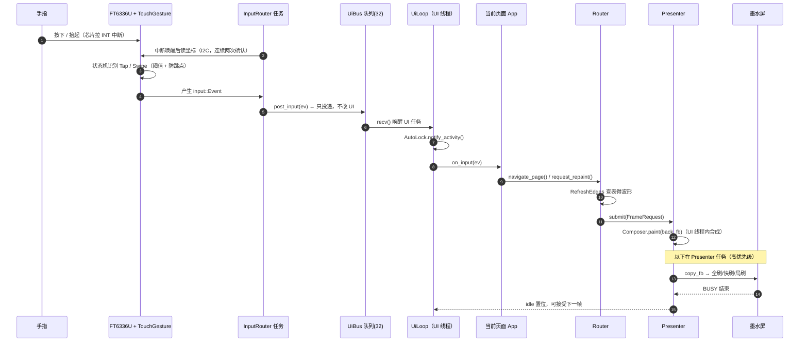

**为什么触摸任务不直接改 UI**（高频面试题）：
FT6336U 的中断和 UI 绘制如果共用一个上下文，就会互相阻塞，还会产生竞态；
把"采集"和"决策"拆开，触摸任务只负责产生事件，UI 只在单线程里改状态 ——
这是整个框架最重要的一条纪律。

---

## 6. 三种刷新波形（墨水屏的灵魂）

墨水屏刷新一次要"抖动"像素，全刷会闪黑、耗时几百毫秒到数秒；局刷快但会留残影。
这套框架把"页面变化"映射成"刷新波形"，**集中在一张表里配置**：

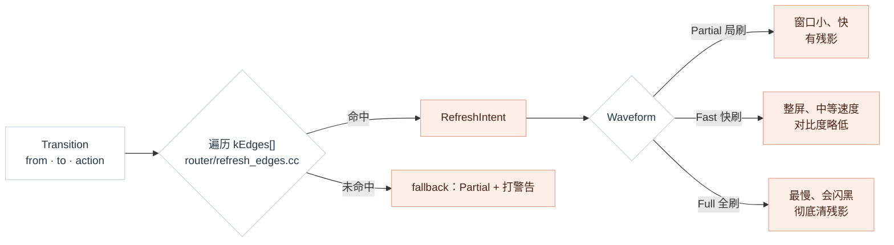

**当前实现的诚实事实**（讲出来反而加分）：
- `Composer` 目前是**整屏合成**，没有做脏区裁剪；所谓"局刷"是
  "整屏 framebuffer 提交 + Partial 波形"，并不是只画变化的矩形。
- 驱动层其实已经支持 8 像素对齐的窗口（`Rect::aligned()`、`Window::normalize()`），
  演进方向就是：Composer 输出脏矩形 → Presenter 只提交脏区 → 真正省时间省电。

**残影治理**：阅读 App 里按"翻页次数"分级 —— 连续 N 次局刷后插入一次全刷
（`ReaderApp::turn_count_`），这是电子书产品的标准做法。

---

## 7. 任务与并发模型

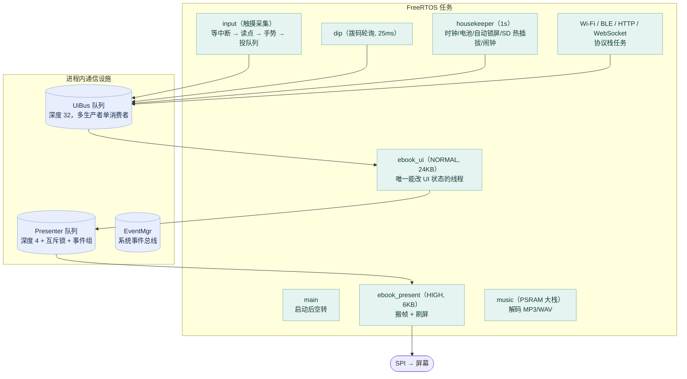

三条纪律：
1. **UI 状态只在 UI 任务里改**，其他任务想改 UI 就 `post` 事件。
2. **UiEvent 结构要小**（≤32 字节，按值进队列），大块数据用指针/ID 传递。
3. **阻塞操作放独立任务**（解码、网络、文件扫描），UI 回调里绝不做 `while(BUSY)`。

---

## 8. 三条典型业务链路

### 8.1 阅读：从书架到翻页

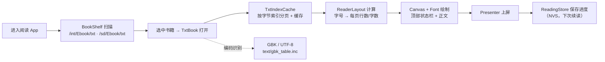

### 8.2 音乐：从文件到声音

### 8.3 天气：网络结果怎么回到 UI

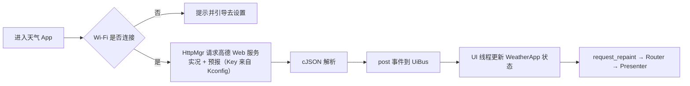

**这条链路的意义**：网络任务与 UI 任务完全解耦，网络慢/失败都不会卡住界面。

---

## 9. 存储与分区

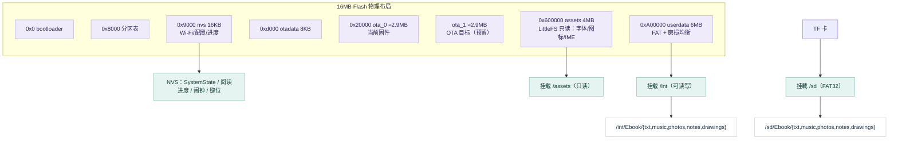

约定：**用户内容只扫描固定子目录，绝不整盘检索**（省时间、行为可预期）。
电脑传文件两条路：USB MSC（把 `/int` 暴露成 U 盘）或局域网 `file_server`。

---

## 10. 新增一个功能要动哪里（扩展点地图）

同样的模式适用于：加设置页（`settings_*`）、加拨码动作（`key_bindings`）、
改刷新策略（只改 `refresh_edges.cc` 或调用时 `override_intent`）。

---

## 11. 面试讲解脚本（3 分钟版）

1. **是什么**（20s）：ESP32-S3 + 2.7 寸墨水屏阅读器，自研 UI 框架，12 个应用。
2. **怎么分层**（40s）：应用 / 框架 / 服务 / 驱动 / 硬件五层，单向依赖；
   指一次画面上屏路径（UI → Router → Composer → Presenter → DisplayPort → SSD1680）。
3. **难点一：墨水屏刷新**（40s）：全刷慢会闪、局刷快有残影，所以做了
   **刷新边表**把"页面跳转"映射成"波形"，配合队列合并只刷最新帧、失败回退 bootstrap、阅读时按翻页次数插入全刷清残影。
4. **难点二：并发与状态**（40s）：UI 单线程纪律；触摸/网络/解码等任务只 post 事件；
   UiBus(32) 与 Presenter(4+锁+idle) 两个队列的分工。
5. **难点三：资源约束**（20s）：5,808 字节一帧的双缓冲、PSRAM 分配、字体/图标走 assets 只读分区。
6. **不足与演进**（20s）：目前整屏合成，下一步做脏矩形局部刷新；OTA 与 EPUB 待完善。

---

## 12. 可能的追问 & 速答

| 问题 | 回答要点 |
|---|---|
| 为什么需要双缓冲？ | 合成与刷屏在不同任务，单缓冲会撕裂；back_fb 在 PSRAM，驱动帧由驱动持有 |
| 队列深度为什么只有 4？ | 墨水屏慢，缓存多了没意义还要吃内存；真正要做的是"合并丢弃旧帧" |
| 局刷为什么必须 8 像素对齐？ | SSD1680 的 X 地址按字节寻址，一个字节 8 像素 |
| 为什么不用 LVGL？ | 屏幕只有 1-bit、RAM 紧、需要控制刷新波形；自研可把"波形策略"做成一等公民 |
| UI 卡顿怎么查？ | 看 `UiLoop::frame_count()`、`Presenter::wait_idle` 超时日志、refresh_edges 未命中警告、BUSY 超时日志 |
| 怎么保证掉电不丢进度？ | 关键状态写 NVS（Persist/Store），写入时机在翻页与退出 |
| 12 个 App 怎么统一？ | 都继承 `App`：`id/title/paint/on_input/on_ui_event/on_semantic_back`，由 AppRegistry 统一开关 |
